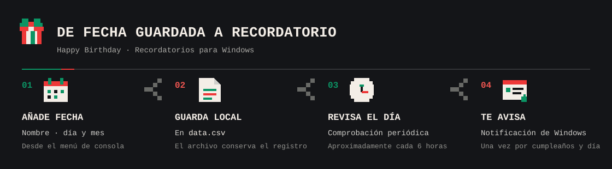

<div align="center">
  
  <h1>Happy Birthday</h1>
  <p>Una agenda de cumpleaños para Windows que convierte una fecha guardada en un recordatorio cuando llega el día.</p>
</div>



## Qué hace

- Guarda nombres y fechas de cumpleaños en `data.csv`.
- Muestra una notificación de Windows si hoy hay un cumpleaños registrado.
- Puede quedarse en segundo plano y revisar las fechas aproximadamente cada seis horas.

## Uso

Desde la carpeta del proyecto, inicia la versión Python:

```powershell
python -m pip install psutil winotify
python main.py
```

También puedes abrir el ejecutable incluido:

```powershell
& ".\resultado final\Happy Birthday.exe"
```

El menú acepta estos comandos:

| Comando | Acción |
| --- | --- |
| `add` | Añadir un nombre y una fecha `dd-mm` |
| `del` | Buscar y eliminar un cumpleaños por nombre o fecha |
| `ok` | Ocultar la consola y dejar el programa en segundo plano |
| `exit` | Cerrar esta instancia |
| `kill` | Cerrar la instancia en segundo plano y salir |

> **Nota:** el menú también anuncia `show`, pero el código publicado no implementa ese comando todavía.

## Inicio automático y datos

Al iniciar, la aplicación intenta añadirse al inicio de sesión de Windows mediante la clave `HKCU\Software\Microsoft\Windows\CurrentVersion\Run`. `ok` deja el proceso funcionando en segundo plano. Ten en cuenta este comportamiento antes de ejecutar el script o el `.exe`.

`data.csv` contiene los nombres y fechas que registres; `already_notified.txt` evita repetir una notificación el mismo día. Haz una copia de seguridad de tus datos y no publiques información personal.

---

README y diagrama preparados con asistencia de IA. El código de la aplicación no se modificó.
